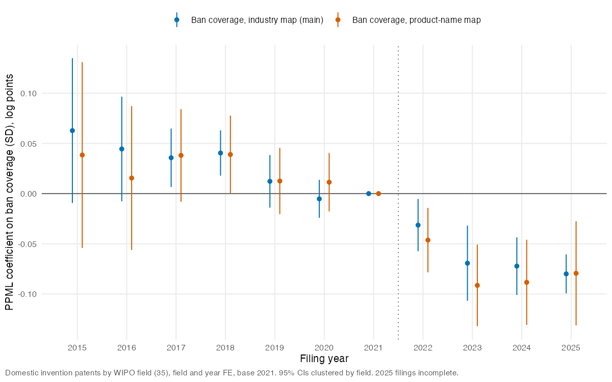
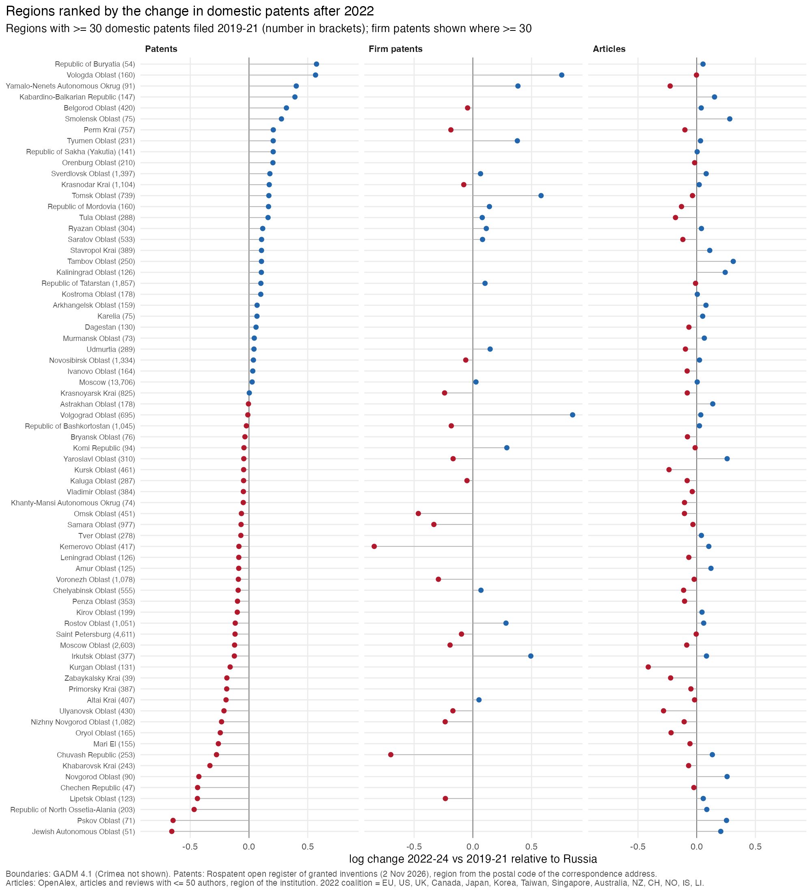

# Sanctions and innovation

Do economic sanctions reduce innovation in the target country? Or do they push the target into **import
substitution**, so that it invents more in the technologies it can no longer buy?

The project starts with a cross-country panel and then narrows to **Russia after 2014 and 2022**. The main design
uses the EU's export bans, which differ in coverage across technology fields, as treatment intensity for domestic
invention by field.

> **Status (Nov 2026): work in progress.** The results below are preliminary. The main event study still shows a pre-trend
> (see [What did not work](#what-did-not-work)). Draft report:
> [`reports/sanctions_innovation_report.pdf`](reports/sanctions_innovation_report.pdf).

---

## Headline figures

**Main test: Russian domestic patents by technology field vs EU export-ban coverage (event study)**



*PPML. 35 WIPO technology fields, field and year fixed effects, base year 2021, 95% CIs clustered by field.
Coefficient per SD of ban coverage (the share of a field's 2019–21 Western imports banned by end-2023). After
2022, fields with more of their imports banned file fewer domestic patents. There is no rise. Fields with high
coverage were already drifting down before 2022 (2017–18 exclude zero).*

**Cross-country check: synthetic difference-in-differences for Iran 2012, Russia 2014 and Russia 2022**


*Synthetic DiD (Arkhangelsky et al. 2021). Donors are countries with no Western economic sanction in force. The
clearest effect is on **non-resident** (foreign) patent filings: about −0.6 log points after Iran 2012 and Russia
2022. Resident (domestic) patents show no effect.*

**Regions of Russia ranked by the change in domestic patents: after 2014 (left) and after 2022 (right)**

<table>
<tr>
<td width="50%"></td>
<td width="50%"></td>
</tr>
<tr>
<td align="center"><b>2014–16 vs 2011–13</b></td>
<td align="center"><b>2022–24 vs 2019–21</b></td>
</tr>
</table>

*Log change relative to Russia as a whole. Regions with ≥ 30 domestic patents in the base window. Panels show
all patents, firm patents and articles. Region comes from the postal code of the patent's correspondence address.
The regional changes after 2014 and after 2022 are almost unrelated (correlation 0.13).*

---

## Data used

| Source | What | Used for | Access |
|---|---|---|---|
| **Rospatent open register** of granted inventions (version 2 Nov 2026) | 867,684 patents: holders, addresses, titles, filing dates | domestic patents by field, region and holder type | public download (by hand) |
| **Google Patents public data** (BigQuery) | Russian patents with IPC codes | IPC codes for the training set of the title classifier; patent types | needs a Google account |
| **EU Council Regulation 833/2014**, 35 consolidated versions | annexes listing banned products (HS/CN codes) and entry dates | ban coverage by field (treatment) | EUR-Lex CELLAR API |
| **CEPII BACI** | bilateral trade, HS6 | Russia's 2019–21 imports from the West, by field | public |
| HS → WIPO field concordances | Dorner–Harhoff industry map (main); product-name map (check) | product → technology field | public / built here |
| **Global Sanctions Data Base (GSDB) V4** | sanction cases, senders, types, years | cross-country treatment | request form (not redistributed) |
| **World Bank WDI** | resident and non-resident patent applications, journal articles, R&D, covariates | cross-country outcomes | public API / bulk |
| **OpenAlex** | articles by country and by Russian region; international co-authorship | science outcomes, regional exposure | public API |
| **Penn World Table** (via FRED) | TFP | cross-country outcome | public |
| OECD / WIPO statistics | patents by technology field and country | Russia 2014 field design | public |
| **GADM 4.1**, russia-cities | boundaries, postal code → region | regional maps | public |

Raw and cleaned data are **not in the repository** (about 3 GB, and some licences do not allow redistribution).
`run_all.sh` downloads and rebuilds them. Every data choice is logged in
[`notes/data_decisions.md`](notes/data_decisions.md).

## Methods used

The main method is **two-way fixed-effects difference-in-differences and event studies**. Where adoption is
staggered, heterogeneity-robust estimators run alongside plain TWFE.

1. **Cross-country panel (1995–2023).** Staggered DiD on a country's first clean Western sanction episode:
   Callaway–Sant'Anna and Sun–Abraham, with never-treated and not-yet-treated controls
   ([note 01](notes/01_cross_country_results.md)). **Synthetic DiD** for three single cases: Iran 2012, Russia
   2014 and Russia 2022. Local projections (onset, LP-DiD) are kept as robustness only.
2. **Title classifier.** Post-2018 Russian patents have no IPC codes in open data. A TF-IDF + logistic regression
   on patent titles assigns them to the 35 WIPO technology fields. Out-of-time top-1 accuracy is 81%. Within-field
   changes correlate 0.91 with IPC-based counts ([note 08](notes/08_title_classifier.md)).
3. **Treatment: EU ban coverage by field.** 35 versions of Reg. 833/2014 are parsed, and each banned HS code is
   dated. Coverage is the share of a field's 2019–21 Western imports that is banned ([note 10](notes/10_ban_coverage.md)).
   First stage: Western imports on coverage, by field.
4. **Main test (pre-registered before any estimate was seen).**
   `P_ft = exp(β · Ban_f · Post_t + α_f + γ_t)`. PPML, 35 fields × 2015–2025, SEs clustered by field, and
   **randomization inference** (2,000 permutations) as the main p-value. Event-study version with base 2021. Six
   pre-specified robustness checks ([note 11](notes/11_patents_ban_test.md)).
5. **Staggered and continuous-dose versions.** Fields are treated when their coverage crosses 50% (cohorts
   2023–25), estimated with Sun–Abraham and Callaway–Sant'Anna. A time-varying dose combines the 2014 and 2022
   episodes.
6. **Regions of Russia (Design D).** Exposure to the West (co-invention and co-authorship with the coalition) ×
   year event studies, region and year FE, PPML. Descriptive maps and rankings of post-2014 and post-2022 changes
   ([note 06](notes/06_regional_maps_results.md)).

## Results so far

| Question | Result |
|---|---|
| **First stage:** did the EU bans cut imports where they applied? | **Yes, strongly.** By end-2023 the bans cover 49% of Russia's 2019–21 Western manufactured imports. 1 SD more coverage → Western imports −0.31 to −0.48 log points (2023), −0.38 to −0.61 (2024). China did **not** replace more in banned fields. |
| **Main test:** did domestic invention move into banned fields? | **No.** β = **−0.092** [−0.114, −0.069] per SD, RI p = 0.0065. All six pre-specified checks are negative. No specification has an upper bound above **+3% per SD**, so substitution larger than that is ruled out. |
| Size of the decline | Uncertain: −9% per SD unadjusted, −7 to −8% in the 2019–25 window, **−2 to −6% after adjusting for the pre-trend** (the interval includes 0 with the main map). |
| Who | The decline is clearest for **research institutes (−12%)** and **universities (−9%)**. Firms −5%, interval just includes 0. |
| Staggered / dose | Robust estimators give −6% to −15% for crossing 50% coverage, about −7% per 10 pp of coverage. Same pre-drift as the main test. |
| National totals after 2022 | Domestic patents +2%, **university patents +19%** (ministry targets), firms +1%; **foreign filings −50%**. |
| Cross-country | Synthetic DiD: non-resident patents about −0.6 after Iran 2012 and Russia 2022; resident patents no effect; TFP null. Staggered DiD: resident patents rise relative to never-treated (mostly rich) countries; this disappears against not-yet-treated countries. |
| Russia 2014 | Narrow controls (oil list, ≤ 4% of any field's imports), mild relative decline, confounded by the oil-price collapse. Fields banned later did not react to 2014. |
| Regions | Large reshuffling (±20–60 log points), but **not explained** by exposure to Western science or co-invention. 2022 winners are industrial, resource and defence regions (Vologda, Tyumen, Perm, Sverdlovsk, Tula). After 2014, Western-linked regions show a suggestive 5–10% per SD rise in firm patenting. |

## What worked

- **The treatment.** Parsing every version of the EU sanctions regulation gives a dated, sender-defined treatment
  by product. It has a strong first stage (correlation with the realised import drop about −0.9).
- **The title classifier.** It recovers technology fields for post-2018 patents that have no open IPC data. It
  is validated out of time and against IPC.
- **Pre-registering the main specification** before estimating, with randomization inference.
- **Regional assignment** from postal codes: it agrees with the town named in the address in 99.6% of cases.
- **Synthetic DiD** for single cases. It matches the pre-period well, and the Python `synthdid` package gives the
  same numbers.

## What did not work

- **Flat pre-trends in the main event study.** Fields with high ban coverage were already drifting down by about
  1% per SD per year before 2022, as Russian invention moved away from machinery and electronics toward life
  sciences. This drift is why the size of the decline is uncertain.
- **The cross-country panel.** It is dominated by a few countries (China, Iran). The never-treated group is mostly
  rich Western countries, and the arms/travel "placebo" behaves like the treatment. Results depend on the
  estimator and the control group.
- **Russia 2014, field design (Design A).** Null result with pre-trends. Russia is not unusual in a permutation
  test across countries.
- **Pre-2022 import share as treatment.** It does not predict the 2022 import loss (pharma and medical goods
  had high Western shares but were exempt). It was replaced by legal ban coverage.
- **Regional trade exposure.** No open region × partner-country trade data was found, so the regional design
  measures knowledge links, not the imported-input channel.
- **IPC for post-2022 patents.** The Rospatent search-platform API needs a token that could not be obtained, hence
  the title classifier.

## Interpretation

1. **Sanctions did not induce import substitution in invention.** Russia lost about half of its Western imports
   in the banned fields, and China did not fill the gap there. Russian inventors did not redirect effort into
   these technologies, after 2022 or after 2014.
2. **Imported inputs and domestic R&D look like complements, not substitutes.** Where there is a response, it
   is a modest relative decline in banned fields. It is concentrated in research institutes and universities.
   This fits lost access to imported lab equipment and components more than firms dropping product lines (not yet
   tested).
3. **The clearest cost is foreign exit.** Foreign patent filings in Russia halved after 2022 (as in Iran
   after 2012). Total domestic patenting stayed flat, held up by university patenting under ministry targets.
4. A possible one-line summary: *a large, sender-defined supply shock with a strong first stage; no substitution
   into the banned technologies (bounded at about +3% per SD); a likely modest relative decline; and the exit of
   foreign inventors.*

Caveats: patents measure inventive output, not quality or use. 2022 is also a military-spending and emigration
shock. The classifier adds measurement error to the outcome (checks with IPC-matched counts give the same result).

## Next directions

1. **Sector × year fixed effects** (WIPO's 5 sectors): compare fields only within their broad sector, so that the
   machinery → life-science drift is removed and the pre-period is flat by design.
2. **HonestDiD (Rambachan–Roth) bounds:** does "no substitution" survive pre-trend violations of M = 1–2?
3. **Region × field × year** with region × year FE as the main robustness check.
4. **Firm-level design:** EU Annex IV military end-users (~970 dated entities) matched to patent holders, with
   not-yet-listed firms as controls.
5. **Regional trade exposure** (Rosstat regional trade data, author data requests, or an industry-mix shift-share)
   and a defence-industry control.
6. **Other outcomes:** utility models and software registrations, where substitution should show first;
   researcher emigration from OpenAlex author histories; citation-based knowledge flows.
7. Cross-country: drop Western "targets", use not-yet-treated and non-high-income controls, and a trade-weighted
   sanction intensity.

---

## Repository layout

| Folder | Contents |
|---|---|
| `scripts/data/` | Python (uv): downloads, parsing, cleaning, panels (01–20) |
| `scripts/analysis/` | R (fixest, did, quadprog): estimation and figures (01–16d) |
| `output/figures/`, `output/tables/` | all figures (PNG + PDF) and result tables (CSV) |
| `notes/` | design notes, results by step (01–11), data decisions, literature notes |
| `reports/` | LaTeX draft report |
| `papers/` | index of the literature (PDFs not redistributed) |
| `data/` | git-ignored; rebuilt by `run_all.sh` |

Start with [`notes/11_patents_ban_test.md`](notes/11_patents_ban_test.md) (main result),
[`notes/02_theory_and_design.md`](notes/02_theory_and_design.md) (theory and designs) and
[`notes/data_decisions.md`](notes/data_decisions.md).

## How to reproduce

Requirements: Python ≥ 3.13 with [uv](https://docs.astral.sh/uv/), R with `fixest`, `did`, `quadprog`, `sf`, `tidyverse`,
`patchwork`, `here`.

```bash
uv sync
./run_all.sh
```

Manual steps (not scriptable):
- GSDB V4 into `data/raw/gsdb/` (request form at globalsanctionsdatabase.com).
- Rospatent register into `data/raw/rospatent/`.
- WDI bulk zip into `data/raw/wb/wdi_bulk/`.
- A Google login for the BigQuery step.

`run_all.sh` skips the Russia stages when the Rospatent, BigQuery or BACI inputs are missing.
