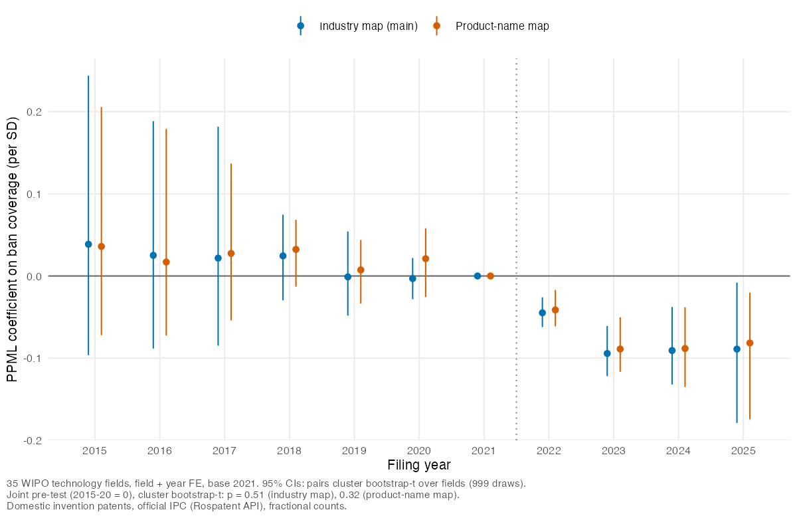
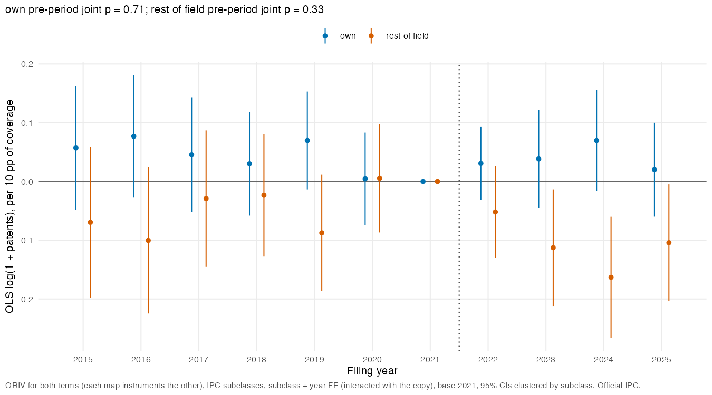
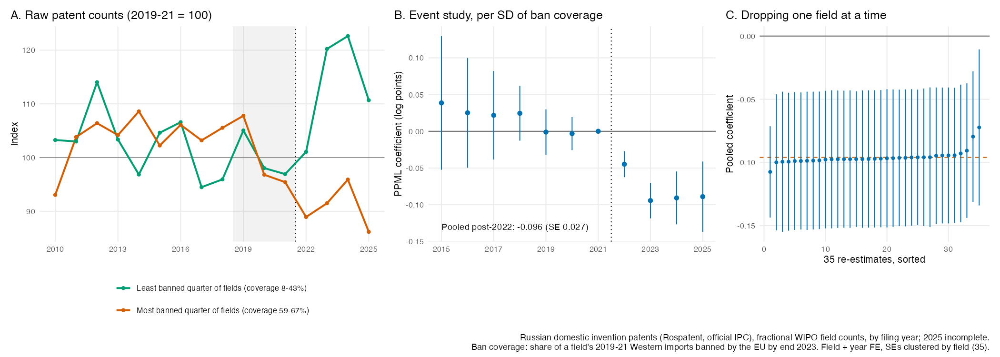
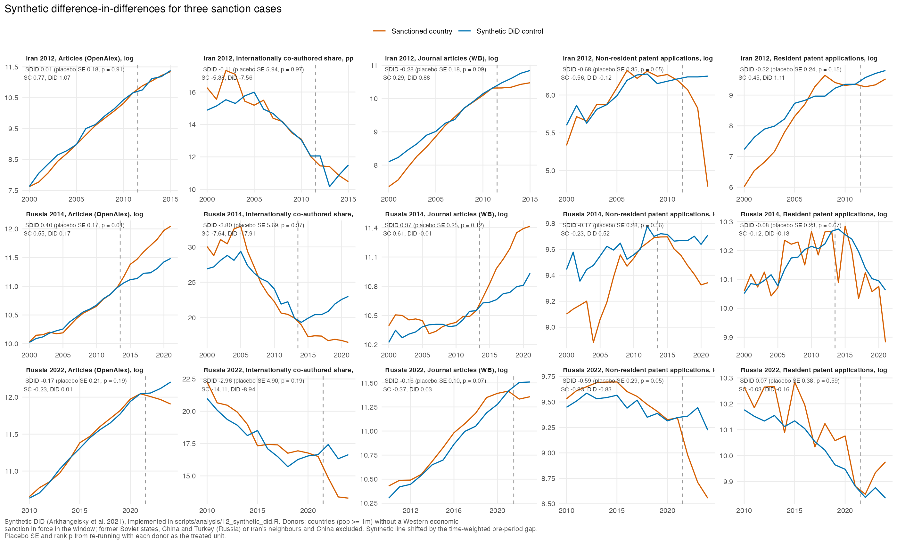
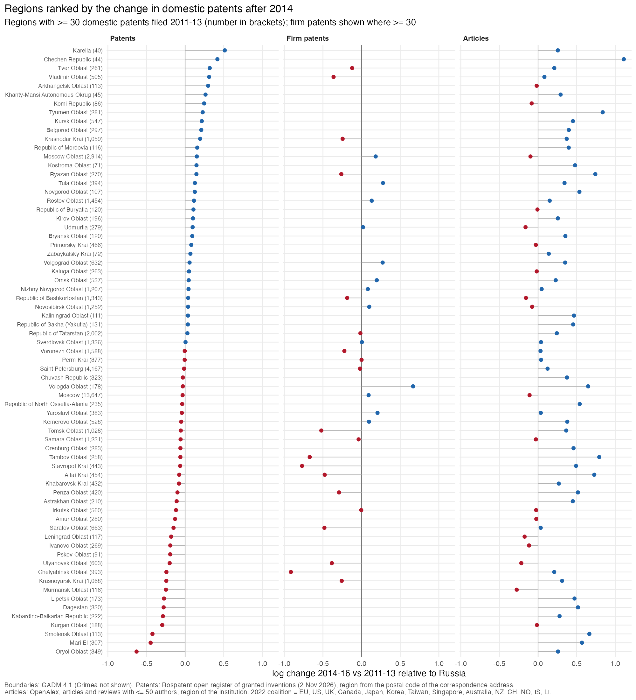

# Sanctions and innovation

Do economic sanctions reduce innovation in the target country? Or do they push the target into **import
substitution**, so that it invents more in the technologies it can no longer buy?

The project starts with a cross-country panel and then narrows to **Russia after 2014 and 2022**. The main design
uses the EU's export bans, which differ in coverage across technology fields, as treatment intensity for domestic
invention by field.

> **Status (19 Nov 2026): work in progress.** All patents now carry **official Rospatent IPC codes** (search-platform
> API, 1994–2026), replacing the title classifier. With official codes the main event study has a **flat pre-period**.
> Latest results: [`reports/sanctions_innovation_results_2026-11-20.pdf`](reports/sanctions_innovation_results_2026-11-20.pdf).
> Estimates are in [`empirics/results/tables/`](empirics/results/tables/).

---

## Headline figures

**Main result: Russian domestic patents by technology field vs EU export-ban coverage (event study)**



*PPML. 35 WIPO technology fields, field and year fixed effects, base year 2021. 95% CIs from a pairs cluster
bootstrap-t over fields (999 draws), which is reliable with few clusters. Coefficient per SD of ban coverage (the share
of a field's 2019–21 Western imports banned by the EU by end-2023), with two independent product→technology maps.
Official Rospatent IPC codes. Before 2022 no coefficient excludes zero and the joint pre-test does not reject
(bootstrap p = 0.51 industry map, 0.32 product-name map). After 2022, fields with more of their imports banned file
fewer domestic patents: **−0.096** [−0.150, −0.042] pooled, randomization-inference p = 0.0015. The estimate is
unchanged by pre-war controls × year (university share, Western import dependence, foreign presence, size: −0.09 to
−0.12) and robust to a continuation of the mild pre-period slope (HonestDiD, Rambachan & Roth 2023). There is no rise
(no import substitution in invention).*

**Within fields: subclasses follow their field's exposure, not their own**



*268 IPC subclasses, subclass and year fixed effects, OLS log(1 + patents), per 10 pp of coverage. Both the
subclass's own ban coverage and the coverage of the rest of its WIPO field enter the same model, each corrected for
map noise by ORIV (Gillen, Snowberg & Yariv 2019: each of the two product→technology maps instruments the other).
Own exposure is about zero throughout; rest-of-field exposure falls after 2022 (−0.11 to −0.16 in 2023–24), though
its pre-period is noisy (joint p = 0.33). Within a field, a subclass's own share of banned imports adds no
explanatory power: the bans act at the level of technology fields.*

**The same result in raw data, with leave-one-out**



*Official IPC codes. (A) Raw patent counts in the most- and least-banned quarter of the 35 WIPO fields, 2019–21 = 100.
(B) PPML event study, field and year fixed effects, base 2021, per SD of ban coverage (the share of a field's 2019–21
Western imports banned by the EU by end-2023), 95% CIs clustered by field: **−0.096** [−0.150, −0.042] after 2022,
randomization-inference p = 0.0015, no pre-period coefficient excludes zero. (C) Dropping one field at a time: −0.072
to −0.107, all below zero. Dropping the five life-science fields together halves the effect (−0.049 [−0.096, −0.002]).*

**Cross-country check: synthetic difference-in-differences for Iran 2012, Russia 2014 and Russia 2022**



*Synthetic DiD (Arkhangelsky et al. 2021). Donors are countries with no Western economic sanction in force. The
clearest effect is on **non-resident** (foreign) patent filings: about −0.6 log points after Iran 2012 and Russia
2022. Resident (domestic) patents show no effect.*

**Regions of Russia ranked by the change in domestic patents: after 2014 (left) and after 2022 (right)**

<table>
<tr>
<td width="50%"></td>
<td width="50%"></td>
</tr>
<tr>
<td align="center"><b>2014–16 vs 2011–13</b></td>
<td align="center"><b>2022–24 vs 2019–21</b></td>
</tr>
</table>

*Log change relative to Russia as a whole. Regions with ≥ 30 domestic patents in the base window. Panels show
all patents, firm patents and articles. Region comes from the postal code of the patent's correspondence address.
The regional changes after 2014 and after 2022 are almost unrelated (correlation 0.13).*

---

## Data used

| Source | What | Used for | Access |
|---|---|---|---|
| **Rospatent open register** of granted inventions (version 2 Nov 2026) | 867,684 patents: holders, addresses, titles, filing dates | domestic patents by field, region and holder type | public download (by hand) |
| **Rospatent search-platform API** | full records of RU invention patents 1994–2026: official IPC/CPC, holders, citations | official technology fields and subclasses; holder types; closeness weights | personal API key (not in repo) |
| **Google Patents public data** (BigQuery) | Russian patents with IPC codes | IPC codes for the training set of the title classifier; patent types | needs a Google account |
| **RFSD** (Russian Financial Statements Database) | firm balance sheets 2011–2025 | planned firm-level design | public (Hugging Face) |
| **EU Council Regulation 833/2014**, 35 consolidated versions | annexes listing banned products (HS/CN codes) and entry dates | ban coverage by field (treatment) | EUR-Lex CELLAR API |
| **CEPII BACI** | bilateral trade, HS6 | Russia's 2019–21 imports from the West, by field | public |
| HS → WIPO field concordances | Dorner–Harhoff industry map (main); product-name map (check) | product → technology field | public / built here |
| **Global Sanctions Data Base (GSDB) V4** | sanction cases, senders, types, years | cross-country treatment | request form (not redistributed) |
| **World Bank WDI** | resident and non-resident patent applications, journal articles, R&D, covariates | cross-country outcomes | public API / bulk |
| **OpenAlex** | articles by country and by Russian region; international co-authorship | science outcomes, regional exposure | public API |
| **Penn World Table** (via FRED) | TFP | cross-country outcome | public |
| OECD / WIPO statistics | patents by technology field and country | Russia 2014 field design | public |
| **GADM 4.1**, russia-cities | boundaries, postal code → region | regional maps | public |

Raw and cleaned data are **not in the repository** (about 3 GB, and some licences do not allow redistribution).
`run_all.py` rebuilds them from `data/raw/` (and downloads what can be scripted with `--with-collection`). Every data
choice is logged in the author's analysis plan (kept private); each raw dataset has a provenance README in
`data/raw/{dataset}/`.

## Methods used

The main method is **two-way fixed-effects difference-in-differences and event studies**. Where adoption is
staggered, heterogeneity-robust estimators run alongside plain TWFE.

1. **Cross-country panel (1995–2023).** Staggered DiD on a country's first clean Western sanction episode:
   Callaway–Sant'Anna and Sun–Abraham, with never-treated and not-yet-treated controls
  . **Synthetic DiD** for three single cases: Iran 2012, Russia
   2014 and Russia 2022. Local projections (onset, LP-DiD) are kept as robustness only.
2. **Title classifier.** Post-2018 Russian patents have no IPC codes in open data. A TF-IDF + logistic regression
   on patent titles assigns them to the 35 WIPO technology fields. Out-of-time top-1 accuracy is 81%. Within-field
   changes correlate 0.91 with IPC-based counts.
3. **Treatment: EU ban coverage by field.** 35 versions of Reg. 833/2014 are parsed, and each banned HS code is
   dated. Coverage is the share of a field's 2019–21 Western imports that is banned.
   First stage: Western imports on coverage, by field.
4. **Main test (pre-registered before any estimate was seen).**
   `P_ft = exp(β · Ban_f · Post_t + α_f + γ_t)`. PPML, 35 fields × 2015–2025, SEs clustered by field, and
   **randomization inference** (2,000 permutations) as the main p-value. Event-study version with base 2021. Six
   pre-specified robustness checks.
5. **Staggered and continuous-dose versions.** Fields are treated when their coverage crosses 50% (cohorts
   2023–25), estimated with Sun–Abraham and Callaway–Sant'Anna. A time-varying dose combines the 2014 and 2022
   episodes.
6. **Regions of Russia (Design D).** Exposure to the West (co-invention and co-authorship with the coalition) ×
   year event studies, region and year FE, PPML. Descriptive maps and rankings of post-2014 and post-2022 changes
  .

## Results so far

| Question | Result |
|---|---|
| **First stage:** did the EU bans cut imports where they applied? | **Yes, strongly.** By end-2023 the bans cover 49% of Russia's 2019–21 Western manufactured imports. 1 SD more coverage → Western imports −0.31 to −0.48 log points (2023), −0.38 to −0.61 (2024). China did **not** replace more in banned fields. |
| **Main test:** did domestic invention move into banned fields? | **No.** With official IPC codes: β = **−0.096** [−0.150, −0.042] per SD, RI p = 0.0015, flat pre-period (2015–2020 all include 0). Same with sector × year FE (−0.096) and with the product-name map. Leave-one-out −0.072 to −0.107. |
| Size of the decline | About **−9% per SD** of coverage. About half comes from the contrast between lightly banned life-science fields (rising, driven by universities) and the rest. |
| Who | **Research institutes (−13%)**, **universities (−10%)**, individuals (−13%); firms −4%, not significant. Public minus firms −0.075 (p = 0.006). |
| Subclasses (IPC, 4 characters) | Across subclasses the drop is present but PPML versions have a pre-trend. **Within fields** there is no break; ORIV (correcting for map noise) does not change this. Subclasses follow the exposure of the rest of their field, not their own. |
| Staggered / dose | Robust estimators give −6% to −15% for crossing 50% coverage, about −7% per 10 pp of coverage. Same pre-drift as the main test. |
| National totals after 2022 | Domestic patents +2%, **university patents +19%** (ministry targets), firms +1%; **foreign filings −50%**. |
| Cross-country | Synthetic DiD: non-resident patents about −0.6 after Iran 2012 and Russia 2022; resident patents no effect; TFP null. Staggered DiD: resident patents rise relative to never-treated (mostly rich) countries; this disappears against not-yet-treated countries. |
| Russia 2014 | Narrow controls (oil list, ≤ 4% of any field's imports), mild relative decline, confounded by the oil-price collapse. Fields banned later did not react to 2014. |
| Regions | Large reshuffling (±20–60 log points), but **not explained** by exposure to Western science or co-invention. 2022 winners are industrial, resource and defence regions (Vologda, Tyumen, Perm, Sverdlovsk, Tula). After 2014, Western-linked regions show a suggestive 5–10% per SD rise in firm patenting. |

## What worked

- **The treatment.** Parsing every version of the EU sanctions regulation gives a dated, sender-defined treatment
  by product. It has a strong first stage (correlation with the realised import drop about −0.9).
- **Official IPC from the Rospatent search-platform API** (1994–2026, 531k documents, 98–99.5% of the register).
  It replaced the title classifier (top-1 accuracy against official codes 70–72%) and removed the pre-trend.
- **ORIV** with the two independent product→technology maps, to correct exposure for measurement error.
- **Pre-registering the main specification** before estimating, with randomization inference.
- **Regional assignment** from postal codes: it agrees with the town named in the address in 99.6% of cases.
- **Synthetic DiD** for single cases. It matches the pre-period well, and the Python `synthdid` package gives the
  same numbers.

## What did not work

- **Flat pre-trends at the subclass level.** The field-level pre-trend disappeared with official IPC codes, but
  across subclasses the more-banned ones were already drifting down before 2022 in PPML specifications.
- **Holder-overlap spillover weights.** Organisations and individuals patent across so many subclasses that the
  weights are too diffuse to be informative.
- **The cross-country panel.** It is dominated by a few countries (China, Iran). The never-treated group is mostly
  rich Western countries, and the arms/travel "placebo" behaves like the treatment. Results depend on the
  estimator and the control group.
- **Russia 2014, field design (Design A).** Null result with pre-trends. Russia is not unusual in a permutation
  test across countries.
- **Pre-2022 import share as treatment.** It does not predict the 2022 import loss (pharma and medical goods
  had high Western shares but were exempt). It was replaced by legal ban coverage.
- **Regional trade exposure.** No open region × partner-country trade data was found, so the regional design
  measures knowledge links, not the imported-input channel.
- **FIPS patent pages** are behind a bot check and were not used; the search-platform API (with a personal key) was.

## Interpretation

1. **Sanctions did not induce import substitution in invention.** Russia lost about half of its Western imports
   in the banned fields, and China did not fill the gap there. Russian inventors did not redirect effort into
   these technologies, after 2022 or after 2014.
2. **Imported inputs and domestic R&D look like complements, not substitutes.** Where there is a response, it
   is a modest relative decline in banned fields. It is concentrated in research institutes and universities.
   This fits lost access to imported lab equipment and components more than firms dropping product lines (not yet
   tested).
3. **The clearest cost is foreign exit.** Foreign patent filings in Russia halved after 2022 (as in Iran
   after 2012). Total domestic patenting stayed flat, held up by university patenting under ministry targets.
4. A possible one-line summary: *a large, sender-defined supply shock with a strong first stage; no substitution
   into the banned technologies (bounded at about +3% per SD); a likely modest relative decline; and the exit of
   foreign inventors.*

Caveats: patents measure inventive output, not quality or use. 2022 is also a military-spending and emigration
shock. The classifier adds measurement error to the outcome (checks with IPC-matched counts give the same result).

## Next directions

1. **Channels:** products vs Western knowledge links (pre-war Western citation and co-invention shares × year), and
   **China replacement** (smaller effect where China replaced the lost Western imports).
2. **Inference for shift-share exposure:** permute product-level bans and rebuild exposure (Adão–Kolesár–Morales);
   wild-cluster bootstrap and HonestDiD bounds.
3. **Exposure measure:** all-origin import denominator (as in Egorov et al.), 8-digit ban lines weighted, Annex VII dating.
4. **Firm-level design:** patent holders → RFSD firm accounts (2011–2025, downloaded) via a name → INN table.
5. **Regional trade exposure** (Rosstat regional trade data, author data requests, or an industry-mix shift-share)
   and a defence-industry control.
6. **Other outcomes:** utility models and software registrations, where substitution should show first;
   researcher emigration from OpenAlex author histories; citation-based knowledge flows.
7. Cross-country: drop Western "targets", use not-yet-treated and non-high-income controls, and a trade-weighted
   sanction intensity.

---

## Repository layout

The package follows a four-stage replication layout (collection, cleaning, processing, analysis).

| Folder | Contents |
|---|---|
| `data/raw/{dataset}/` | raw data as downloaded or provided (git-ignored); a provenance `README.md` per dataset; checksums in `data/raw/MANIFEST.sha256` |
| `data/clean/{dataset}/` | cleaned source datasets (git-ignored) |
| `data/processed/{workfile}/` | analysis-ready workfiles (git-ignored) |
| `data/scripts/collection/` | `acquire_{dataset}.py`: downloads into `data/raw/` |
| `data/scripts/cleaning/` | `clean_{dataset}.*`: raw → clean |
| `data/scripts/processing/` | `process_{workfile}.*`: clean → workfiles |
| `data/scripts/utils/`, `data/scripts/checks/` | shared helpers; baseline comparison |
| `empirics/scripts/` | `NN_{explore,analyze,robust}_{what}.R`, numbered in run order; `00_setup.R` and helpers |
| `empirics/results/` | `tables/` (CSV), `figures/` (PNG + PDF), `logs/` |
| `reports/` | LaTeX reports |
| `papers/` | index of the literature (PDFs not redistributed) |
| `archive/` | superseded files; `script_rename_map.csv` maps the old script names (e.g. `18t`, `23b`) to the new ones; `data_file_map.csv` lists every data file and the script that writes it |
| `attempts-log.csv`, `mismatch-register.csv` | run register (appended by `run_all.py`); replication mismatches (none: this is not a replication of a published paper) |

## How to reproduce

Requirements: Python ≥ 3.13 with [uv](https://docs.astral.sh/uv/), R with `fixest`, `did`, `quadprog`, `sf`,
`tidyverse`, `patchwork`, `here`, `concordance`, `HonestDiD`.

```bash
uv sync
uv run python run_all.py              # cleaning -> processing -> empirics, from data/raw/
uv run python run_all.py --list       # all steps and their dependencies
uv run python run_all.py --check      # rerun and compare outputs with archive/baseline
```

`--with-collection` also re-downloads the scriptable sources. It needs network access, the environment variable
`ROSPATENT_TOKEN` (a personal Rospatent search-platform API key), and `GCP_PROJECT` with a cached Google login for
BigQuery. Each step writes its log to `data/logs/{script}.log` or `empirics/results/logs/{script}.log`.

Raw files that cannot be downloaded by script (see each `data/raw/{dataset}/README.md`): GSDB V4 (request form),
the Rospatent invention register, BACI, the WDI bulk zip, WIPO indicators, BEA and Rosstat input-output tables,
the EU dual-use correlation tables (CIRCABC), the Dorner-Harhoff concordances, TN VED product names, GADM and
russia-cities. The optional Python `synthdid` cross-check (`empirics/scripts/10_robust_synthdid_python.py`) needs a
separate environment (see its header).
